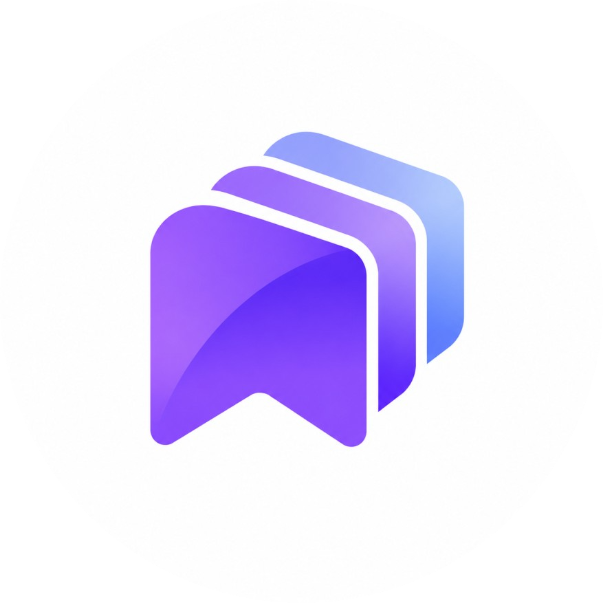

<div align="center">



# Shelf

**The links you love. Beautifully organized. Entirely yours.**

A fast, private, offline-first bookmark manager for Android.<br>
Drop a link, grab the details, and move on.

<p>
  <a href="https://github.com/iambhvsh/shelf/releases/latest"></a>
  <a href="https://github.com/iambhvsh/shelf/releases"></a>
  <a href="https://github.com/iambhvsh/shelf/stargazers"></a>
  <a href="https://github.com/iambhvsh/shelf/issues"></a>
  <a href="LICENSE"></a>
  
  
</p>

<p>
  <a href="https://github.com/iambhvsh/shelf/forks"></a>
  <a href="https://github.com/iambhvsh/shelf/watchers"></a>
  <a href="https://github.com/iambhvsh/shelf/commits"></a>
  <a href="https://github.com/iambhvsh/shelf/pulls"></a>
  
  
  
</p>

<p>
  <a href="https://github.com/iambhvsh/shelf/releases/latest/download/shelf-release.apk"></a>
  <a href="https://rookieenough.github.io/Orion-Data/redirect.html?id=shelf"></a>
  <a href="https://shelf.iambhvsh.in"></a>
</p>

[Features](#features) &nbsp;|&nbsp; [Install](#install) &nbsp;|&nbsp; [Privacy](#privacy) &nbsp;|&nbsp; [Tech stack](#tech-stack) &nbsp;|&nbsp; [Build](#build-from-source) &nbsp;|&nbsp; [FAQ](#faq) &nbsp;|&nbsp; [Stats](#project-stats) &nbsp;|&nbsp; [Contributing](#contributing) &nbsp;|&nbsp; [Changelog](https://github.com/iambhvsh/shelf/releases)

</div>

---

## Overview

Most bookmark apps are either packed with features nobody asked for or gated behind a subscription. Shelf does one thing well: save a link, fetch its details, and stay out of your way.

- No accounts or sign-ups
- No cloud lock-in
- No ads or trackers
- Fully functional offline

Shelf is a fork of [Savr](https://github.com/qeiq/Savr) by [qeiq](https://github.com/qeiq), rebuilt with a refined Material 3 interface and a broader feature set.

## Features

**Capture**
- **Instant metadata.** Title, description and preview image are fetched automatically. Background crawling handles basic anti-bot protection.
- **Share-sheet saving.** Share from Chrome, X, Reddit or any app. The link is saved without opening Shelf.
- **Duplicate detection.** Saving a link that already exists in a collection warns you immediately.

**Organize**
- **Collections and tags.** Flat collections with tags for cross-referencing. No nested folders.
- **Pinning.** Keep important links at the top.
- **Bulk actions.** Select multiple bookmarks to delete or move them at once.
- **Sorting.** Order your library the way you prefer.
- **Personal notes.** Add private context directly on a bookmark card.

**Find and revisit**
- **Full-text search** across titles, URLs, descriptions and notes.
- **Custom reminders.** Choose the exact date and time Shelf should bring a link back.
- **Configurable tap action.** Open in browser, show a preview card, copy the URL, or share via the Android share sheet.
- **Grid and list views.**

**Customize**
- **Material 3** with Light, Dark and true OLED Black themes.
- **Eight accent colors**, or Dynamic Color (Material You) to follow your wallpaper.
- **Native splash screen** on Android 12 and later.

**Security and data**
- **App lock** using device biometrics.
- **Import and export** as JSON or HTML, including exports from desktop browsers.
- **Automatic daily backups** to internal storage and the Downloads folder.
- **In-app updates.** Shelf checks GitHub Releases and installs new versions over the air.

## Install

| Source | Link |
| :--- | :--- |
| GitHub Releases | [Download the latest APK](https://github.com/iambhvsh/shelf/releases/latest/download/shelf-release.apk) |
| Orion Store | [Get it on Orion Store](https://rookieenough.github.io/Orion-Data/redirect.html?id=shelf) |

1. Download the APK.
2. Allow installs from your browser or file manager when prompted.
3. Open Shelf. Future updates are delivered in-app.

## Privacy

| | |
| :--- | :--- |
| Accounts | None |
| Ads and trackers | None |
| Data location | Stored on your device only |
| Network use | Fetching link previews and checking GitHub for updates |
| Offline use | Fully supported |
| License | GPL-3.0 |

## Tech stack

| Layer | Technology |
| :--- | :--- |
| Language | Kotlin |
| UI | Jetpack Compose, Material 3 |
| Architecture | MVI with StateFlow |
| Database | Room |
| Networking | OkHttp, Jsoup |
| Image loading | Coil |

## Build from source

Requirements: latest stable Android Studio, JDK 17.

```bash
git clone https://github.com/iambhvsh/shelf.git
cd shelf
./gradlew assembleDebug
```

The APK is written to `app/build/outputs/apk/debug/`.

## FAQ

<details>
<summary><b>Does Shelf sync across devices?</b></summary>
<br>
No. Data stays on your device. Use JSON or HTML export and import to move your library.
</details>

<details>
<summary><b>Does it need an internet connection?</b></summary>
<br>
Only to fetch link previews and check for updates. Everything else works offline.
</details>

<details>
<summary><b>Can I import bookmarks from my desktop browser?</b></summary>
<br>
Yes. Export your bookmarks as HTML from the browser and import the file in Shelf.
</details>

<details>
<summary><b>Where are backups stored?</b></summary>
<br>
Daily backups are saved to internal storage and the Downloads folder.
</details>

## Project stats

<p align="center">
  <a href="https://github.com/iambhvsh/shelf/releases"></a>
  <a href="https://github.com/iambhvsh/shelf/graphs/commit-activity"></a>
  <a href="https://github.com/iambhvsh/shelf/issues?q=is%3Aissue+is%3Aclosed"></a>
</p>

### Star history

<a href="https://star-history.com/#iambhvsh/shelf&Date">
  <picture>
    <source media="(prefers-color-scheme: dark)" srcset="https://api.star-history.com/svg?repos=iambhvsh/shelf&type=Date&theme=dark">
    <source media="(prefers-color-scheme: light)" srcset="https://api.star-history.com/svg?repos=iambhvsh/shelf&type=Date">
    
  </picture>
</a>

### Contributors

<a href="https://github.com/iambhvsh/shelf/graphs/contributors">
  
</a>

## Contributing

Bug reports and feature ideas are welcome. [Open an issue](https://github.com/iambhvsh/shelf/issues) with clear reproduction steps or a short description of the idea. For code changes, open an issue first to discuss the approach, then submit a pull request.

## Support

Shelf is free, open source and has no ads. If it helps keep your links in order, consider supporting development.

<a href="https://www.buymeacoffee.com/iambhvsh"></a>

A star on GitHub also helps.

## Acknowledgements

- [Savr](https://github.com/qeiq/Savr) by [qeiq](https://github.com/qeiq). The foundation Shelf is forked from.
- [Android-Link-Preview](https://github.com/vishalkumarsinghvi/Android-Link-Preview) by Vishal Kumar Singhvi. Powers metadata extraction.

## License

Licensed under the [GNU General Public License v3.0](LICENSE).