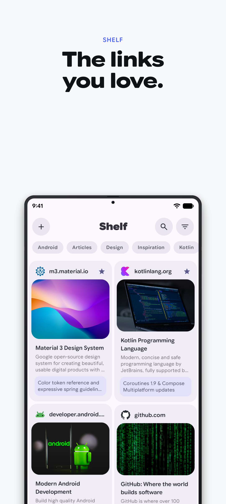
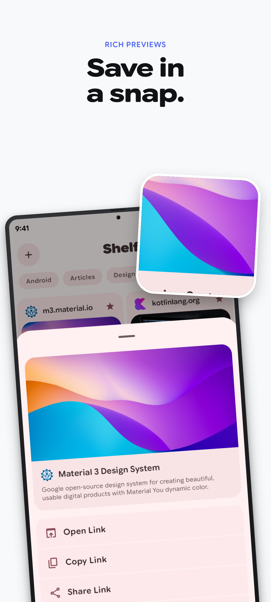
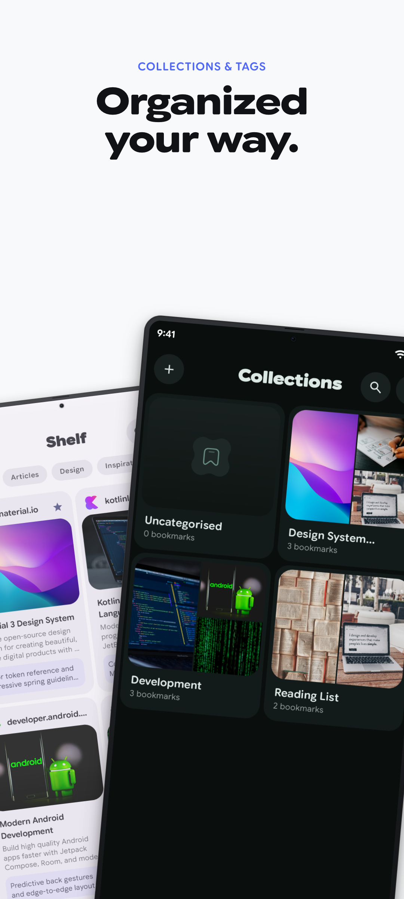
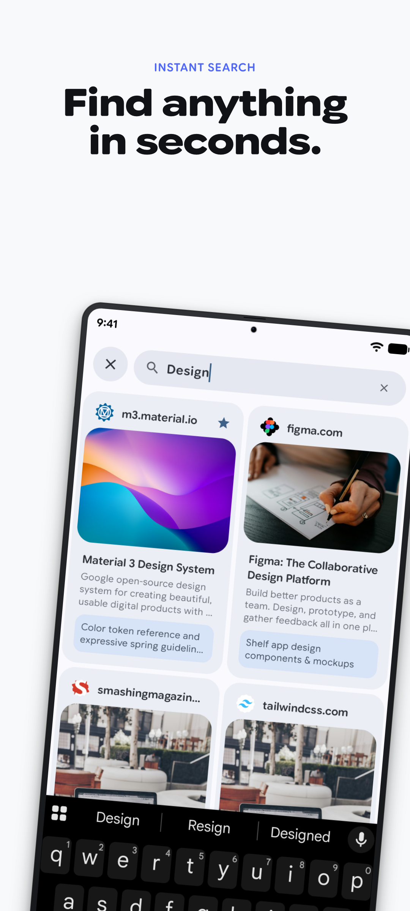
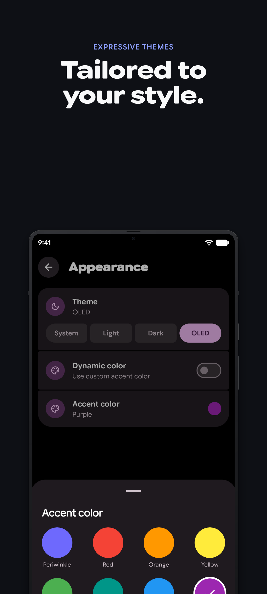
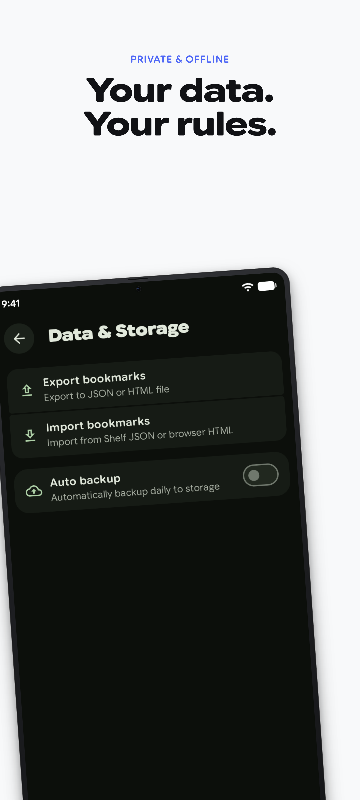

<div align="center">


# Shelf

**The links you love. Beautifully organized. Entirely yours.**

A fast, private, offline-first bookmark manager for Android.

<p>
  <a href="https://github.com/iambhvsh/shelf/releases/latest"></a>
  <a href="https://github.com/iambhvsh/shelf/releases"></a>
  <a href="https://github.com/iambhvsh/shelf/stargazers"></a>
  <a href="LICENSE"></a>
</p>

<p>
  <a href="https://github.com/iambhvsh/shelf/releases/latest/download/shelf-release.apk"></a>
  <a href="https://rookieenough.github.io/Orion-Data/redirect.html?id=shelf"></a>
</p>

[Website](https://shelf.iambhvsh.in) · [Changelog](https://github.com/iambhvsh/shelf/releases) · [Report a bug](https://github.com/iambhvsh/shelf/issues)

</div>

## Table of contents

- [Overview](#overview)
- [Screenshots](#screenshots)
- [Features](#features)
- [Install](#install)
- [Privacy](#privacy)
- [Tech stack](#tech-stack)
- [Build from source](#build-from-source)
- [Contributing](#contributing)
- [Support](#support)
- [Acknowledgements](#acknowledgements)
- [License](#license)

## Overview

Most bookmark apps are either packed with features nobody asked for or gated behind a subscription. Shelf does one thing well: save a link, fetch its details, and stay out of your way.

- No accounts or sign-ups
- No cloud lock-in
- No ads or trackers
- Fully functional offline

Shelf is a fork of [Savr](https://github.com/qeiq/Savr) by [qeiq](https://github.com/qeiq), rebuilt with a refined Material 3 interface and a broader feature set.

## Screenshots

<div align="center">
  
  
  
  <br/><br/>
  
  
  
</div>

## Features

**Capture**
- **Instant metadata.** Title, description, and high-resolution preview image are fetched automatically, with background crawling that handles basic anti-bot protection.
- **Share-sheet saving.** Share links directly from any browser or app. Assign collections and add or create tags on the fly without interrupting your workflow.
- **Duplicate detection.** Saving a link that already exists in your library or in a collection warns you immediately.

**Organize**
- **Collections and tags.** Clean, flat collections with flexible tags for seamless cross-referencing and quick filtering.
- **Pinning, sorting, and bulk actions.** Pin key bookmarks to the top, sort by date added or title, and select multiple items to move or delete at once.
- **Rename and notes.** Customize bookmark titles and attach private, multiline notes directly to any bookmark card.

**Find and revisit**
- **Full-text search.** Instant live search across titles, URLs, descriptions, and private notes.
- **Custom reminders.** Schedule exact notifications with date and time pickers to bring important links back to your attention.
- **Configurable tap action.** Choose what happens on tap: open directly in browser, show preview sheet, or copy the URL.
- **Grid and list layouts.** Switch effortlessly between responsive grid cards and compact list rows.

**Customize**
- **Material 3 Expressive.** Fluid spring animations, expressive bottom sheets, and variable Google Sans Flex typography.
- **Theme modes.** Seamless switching between System default, Light, Dark, and true pitch-black OLED themes.
- **Nine accent palettes.** Choose from Periwinkle, Red, Orange, Yellow, Green, Teal, Blue, Purple, and Pink, or enable Dynamic Color (Material You) to match your system wallpaper.

**Security and data**
- **App lock.** Protect your bookmarks with device biometrics (fingerprint / face unlock) or device credential fallback (PIN / pattern / password), with configurable auto-lock timeouts.
- **Bidirectional import and export.** Full Netscape bookmark HTML import/export compatible with desktop browsers (Chrome, Firefox, Safari, Edge, Brave), plus native JSON backups.
- **Automatic daily backups.** Scheduled daily backups saved locally or to any folder of your choice via the Android Storage Access Framework (SAF).
- **In-app updates.** Check, download, and install new Shelf releases over-the-air from the app itself or from [Orion Store](https://rookieenough.github.io/Orion-Data/redirect.html?id=shelf).

## Install

1. Download the [latest APK](https://github.com/iambhvsh/shelf/releases/latest/download/shelf-release.apk), or get Shelf from [Orion Store](https://rookieenough.github.io/Orion-Data/redirect.html?id=shelf).
2. Allow installs from your browser or file manager when prompted.
3. Open Shelf. Future updates are delivered in-app.

## Privacy

| Privacy | Details |
| :--- | :--- |
| **Accounts** | None |
| **Ads and trackers** | None |
| **Data location** | On your device only |
| **Network use** | Link previews and update checks |

## Tech stack

| Layer | Technology |
| :--- | :--- |
| Platform | Android 9.0+ (API 28–36) |
| Language | Kotlin |
| UI | Jetpack Compose, Material 3 Expressive |
| Architecture | MVI with StateFlow |
| Dependency Injection | Koin |
| Database | Room (SQLite) |
| Networking | OkHttp, Jsoup |
| Image loading | Coil |
| Theming | MaterialKolor |
| Security | AndroidX Biometric |
| Serialization | Kotlinx Serialization |
| Markdown | Multiplatform Markdown Renderer |

## Build from source

Requirements: latest stable Android Studio, JDK 17.

```bash
git clone https://github.com/iambhvsh/shelf.git
cd shelf
./gradlew assembleDebug
```

The debug APK is written to `app/build/outputs/apk/debug/app-debug.apk`. To build an optimized release APK:

```bash
./gradlew assembleRelease
```

## Contributing

Bug reports and feature ideas are welcome. [Open an issue](https://github.com/iambhvsh/shelf/issues) with clear reproduction steps or a short description of the idea. For code changes, open an issue first to discuss the approach, then submit a pull request.

## Support

Shelf is free and open source. If it helps, consider supporting development.

<a href="https://www.buymeacoffee.com/iambhvsh" target="_blank">
  
</a>

<br>

<a href="https://star-history.com/#iambhvsh/shelf&Date">
  <picture>
    <source media="(prefers-color-scheme: dark)" srcset="https://api.star-history.com/svg?repos=iambhvsh/shelf&type=Date&theme=dark">
    <source media="(prefers-color-scheme: light)" srcset="https://api.star-history.com/svg?repos=iambhvsh/shelf&type=Date">
    
  </picture>
</a>

## Acknowledgements

- [Savr](https://github.com/qeiq/Savr) by [qeiq](https://github.com/qeiq). The foundation Shelf is forked from.
- [Android-Link-Preview](https://github.com/vishalkumarsinghvi/Android-Link-Preview) by Vishal Kumar Singhvi. Powers metadata extraction.

## License

Licensed under the [GNU General Public License v3.0](LICENSE).